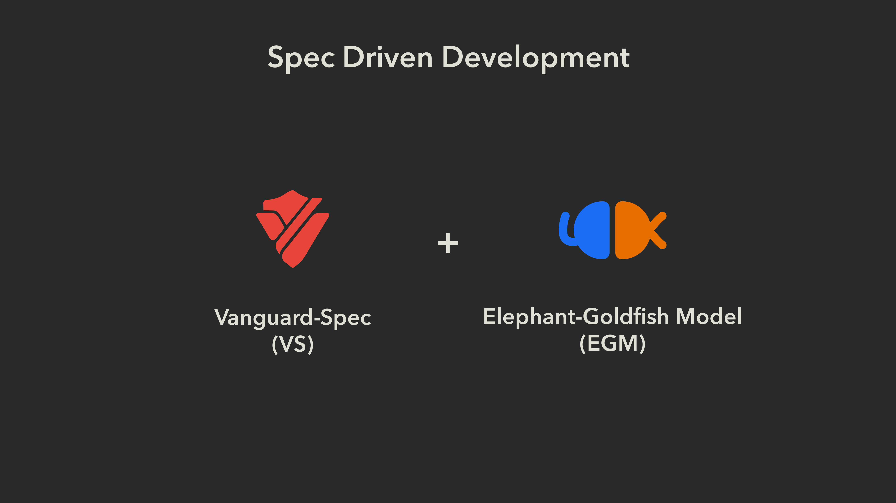

Let me start with a confession: I got tired of spec-driven development.
<!--more-->

[](vs-egm.png)

The idea is lovely. Write the spec first, code second, and give the AI some rails to run on. But here's what I kept seeing in practice. You type a request, and a few seconds later you have a thirty-page document. Every heading is present and accounted for, and nobody can read it. We went straight from *request* to *document* and skipped every step in between. Those steps are exactly where the risk gets squeezed out.

Then I found EGM.

## Elephants and goldfish

The Elephant-Goldfish Model (EGM) is [Dave Rensin's method](https://www.linkedin.com/search/results/all/?keywords=elephant%20goldfish%20model&origin=HISTORY&position=0). Dave is a Distinguished Engineer at Google. The idea is simple:

- **The Elephant** is a long working session with the AI. It remembers everything: the architecture, the intent, the small decisions along the way. It writes no code. It interviews you, argues with you, and keeps the record.
- **The Goldfish** is a brand-new AI session with no memory. It's handed the design doc and nothing else. If it misunderstands the plan, that's not the goldfish's fault. The doc isn't clear enough.

The process runs in three phases: brainstorm, draft, review. Only when a goldfish can read the doc and get it right does any code get written. Dave's one-line summary: *"Design is the new code."* When AI writes code faster than humans can read it, the thing you actually need to control is the design.

What I love about EGM is that it **forces you to go slowly in exactly the right places**. No document exists just because someone pressed Enter. It has to survive interrogation by goldfish who have no reason to be polite to you.

I built Vanguard with that very process: brainstorm, draft, review, review again. It moved astonishingly fast, because every small step had been challenged before the next one began. So this post isn't only an introduction to a tool. It's a thank-you, and it's the next idea I'd like to contribute back to EGM.

## The new pain

EGM answers one question brilliantly: *is this document good enough to build from?*

But live with EGM for a while and you hit the next question, and it's a nastier one:

> **Is this document still true?**

Picture it six months from now. You have a few hundred markdown files. Modules change daily. Ten people on the team, each poking at a different corner. There's a file called `payments-spec.md`. Who owns it? When did someone last actually read it? How many times has `src/payments/` changed since?

Nobody knows. And here's the worst part: **nothing warns you.**

You might think git has this covered. The docs sit next to the code, same repo, same history. But *adjacent* doesn't mean *in sync*. Git remembers perfectly well that both files changed. It has no idea, and no reason to, that one file describes the other. Proximity gives you a feeling of safety, and that feeling has never been tested.

Today's spec-driven tools don't close this gap either. OpenSpec makes drift less likely *if everyone follows the workflow*, but one direct code edit that skips the change folder and no alarm rings. Drift scans are pull-based: they work if someone remembers to run them. And if there's one thing humans reliably forget, it's going to inspect something that looks fine.

Put differently: the elephant remembers wonderfully. But a document is an elephant that remembers the things that stopped being true, and it recalls them with the same confidence as the things that are.

## Vanguard: the one who knocks

Vanguard is a small, standalone command-line tool that manages the lifecycle state of your documents. It answers exactly one question, deterministically:

> **Which documents have gone stale, and what exactly made them stale?**

No LLM inside. No daemon. No server. Same inputs, same output, every time.

The mechanism is simple. Each document declares which code it's watching:

```yaml
---
id: payments-spec
schema: feature-spec
watches:
  paths: ["src/payments/**"]
  review_after: 90d
---
```

A human reads the doc, checks it against the code, decides it's accurate, and runs `vanguard observe payments-spec`. That's the attestation: *"I reviewed this, and it's accurate as of this commit."* It's recorded in a single file, `vanguard.lock`, committed like `go.sum`. From then on, if the code in `src/payments/` changes, or 90 days pass with no review, or the document itself is edited without being re-attested, the document turns **stale**, with the exact commits, paths, and reasons attached.

Day to day, it's a handful of commands:

```text
vanguard init                                      # scaffold .vanguard/
vanguard observe payments-spec                     # "I reviewed it, it's accurate"
vanguard check                                     # which docs are stale, and why?
vanguard check --path src/payments --format json   # an agent asks before editing
```

That last line is what excites me most. Before touching the payments module, an AI agent can ask, "Does any document describe this code that has gone stale?" and get back structured JSON plus an exit code CI can act on immediately.

## How much Vanguard's answer actually means

This is the most important part of the post, so I'll say it plainly.

**Vanguard manages the lifecycle state of your documents. It cannot tell you whether a document is still correct.** No tool built on hashes and commits can. All it knows is two things: *when a human last attested*, and *whether what the document watches has changed since.*

So read the two states carefully:

- **Fresh** does not mean "correct." It means: *a human reviewed it, and nothing the document watches has changed since.*
- **Stale** does not mean "wrong." It means: *the basis of the last attestation has changed.* The code may have been merely refactored, and the document could still be right, word for word. Vanguard tells you *that it's stale and why*. Whether it's actually wrong is a human judgment.

Two consequences follow.

**First, marking a document fresh or stale only means something when it passes through human review.** If someone runs `observe` without actually reading, Vanguard won't catch it. What it does is turn that claim into a line in a git diff, where a reviewer can see it, question it, and trace who said "it's accurate." The machine records accountability. The human carries it.

**Second, you still need other spec-driven skills like EGM to do the real verification.** When Vanguard flags a document as stale, that's when the actual work begins: comparing the document against the current code, deciding what to change, and checking whether the update is clear enough. That is EGM's territory. The elephant holds the context to revisit the intent with you, a goldfish rereads the update with no bias, and hostile reviewers hunt for gaps. Vanguard replaces none of those steps. It tells you *which documents belong in that process, and why.*

The full loop looks like this:

1. Code changes and is committed.
2. Vanguard reports: `payments-spec` has gone stale, and here are the commits that made it so.
3. A human, with EGM, reviews: is the document still right? What needs fixing? Does a fresh goldfish still understand it?
4. The document is updated and committed.
5. A human runs `observe`: a new attestation.
6. The lock file is committed. The attestation becomes a reviewable piece of history.

The machine measures and reports. The human, supported by EGM, judges.

## Five principles

1. **Fresh only when attested.** Staleness clears only through a human `observe`, committed to git. Editing the doc isn't enough.
2. **Never silently fresh.** A lost lock, a broken link, a bad file: always red.
3. **One deterministic answer.** Which docs are stale, and which commit did it.
4. **Zero opinions.** The engine owns only identity, watches, and the lock. Layout, schemas, and style rules are yours — the engine only enforces what *you* declared.
5. **Machine-native output.** A JSON envelope and exit bits for CI and agents. The tool teaches itself through `--help` and its own error messages.

And a sixth, which is also where it came from: **EGM drives the workflow.**

## Putting it together

If EGM answers *"is this document good enough to start?"*, Vanguard tells you *which documents have gone stale and what made them stale*, so you know when it's time to ask that question again.

The goldfish checks the document when it's born, and again whenever it's updated. Vanguard knocks on the door when the foundation of the last check no longer holds. They don't replace each other. They're two halves of one lifecycle.

Dave Rensin said design is the new code. I'd add one clause: **design that has gone stale without anyone knowing is worse than no design at all.**

## Where to get it

Vanguard is Apache-2.0, written in Go, with no runtime dependencies. Grab a binary from the [releases page](https://github.com/vanguard-lint/vanguard-spec/releases) (v0.2.0 shipped this week), read the [design document](https://github.com/vanguard-lint/vanguard-spec/blob/main/.vanguard/docs/design/vanguard.md), or browse the [source](https://github.com/vanguard-lint/vanguard-spec) — the engine checks its own store on every commit, so the README you read there is attested fresh.
